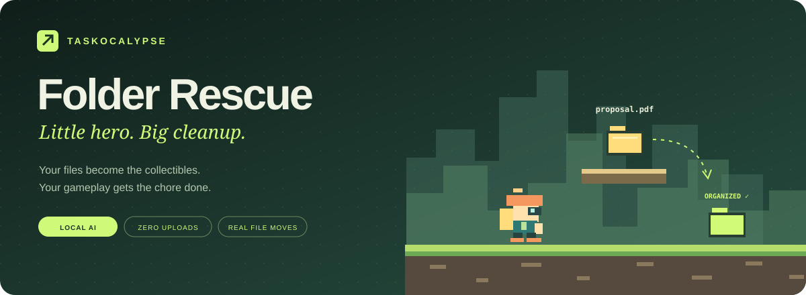
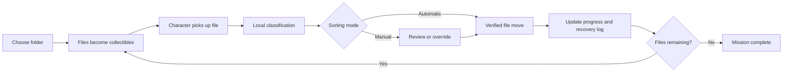

<div align="center">



### Play a little. Clear a lot.

**A platform adventure that organizes your actual files while you play.**


[The idea](#the-idea) · [Gameplay](#how-to-play) · [Run locally](#run-locally) · [Deploy](#deploy-on-vercel) · [Under the hood](#under-the-hood) · [Safety](#your-files-your-control)

</div>

---

## The idea

Digital chores are easy to postpone. A messy Downloads folder becomes tomorrow's problem—again.

**Taskocalypse: Folder Rescue** makes that chore the game itself. Choose a folder and its files become collectibles in an original side-scrolling world. Guide **Nori**, your orange-helmeted courier, through the level. Each file you touch is classified and organized into a real destination folder in the background.

There are no unrelated coin objectives. **The collectibles are the work.** When every eligible file is organized, the mission ends.

> **Chosen vertical:** digital file organization.  
> **Persona:** a student or busy professional overwhelmed by digital clutter.  
> **Challenge:** Taskocalypse / Prompt Wars.

## What makes it different

| Feature | What you get |
| :--- | :--- |
| **Gameplay with a real payoff** | Picking up a file executes an actual organization operation after you choose your folder. |
| **Automatic by default** | Local classification chooses a destination and the engine moves the file while the adventure continues. |
| **Manual whenever you want** | Settings → Sorting mode → Manual lets you review and change each destination. Your preference persists. |
| **A private, local assistant** | File-type detection and a small learned filename model run on your device. No AI API key or file uploads. |
| **Verified moves and undo** | SHA-256 checks, collision refusal, and a browser-local recovery journal protect the workflow. |
| **A complete sample mission** | Judges and visitors can play immediately without giving access to personal files. |
| **Inclusive play** | Keyboard and touch controls, untimed missions, reduced motion, Assist mode, and a movement-free pickup option. |

## How to play

### 1 · Choose your workspace

Select **Choose my folder** and grant access to a folder in a supported desktop browser. Or select **Try sample folder** for a twelve-file mission that never changes anything on your device.

The game explains the active sorting mode before you connect a real folder. In Automatic mode, **touching a file moves it**.

### 2 · Collect the clutter

Run and jump to pick up the files appearing in the landscape. Automatic mode classifies each pickup and organizes it in the background. Successfully completed operations advance your progress.

Prefer to make the call? Enable **Manual** in Settings. Pickups then open a question inside the game with the filename, suggestion, reason, and destination preview. Choose a category and confirm, or defer the file for later.

### 3 · Finish the folder

The mission ends automatically when all eligible files have been organized. Review completed moves—or undo them—in **Rescue log**.

| Control | Action |
| :--- | :--- |
| `A` / `D` or `←` / `→` | Move |
| `Space`, `W`, or `↑` | Jump |
| `P` or `Escape` while the game has focus | Pause / resume |
| `1`–`6` during Manual review | Choose a destination |
| `E` during Manual review | Confirm the displayed move |
| On-screen arrow and jump buttons | Touch controls |
| **Pick up next file** | Play without movement requirements |
| **Assist mode** | Keep collectibles at ground level |

## A real before and after

```text
YOUR FOLDER                         AFTER PLAYING
│                                   │
├── project-proposal.pdf             └── Rescued/
├── sunset-weekend.jpg                   ├── Documents/
├── launch-video.mp4                     │   └── project-proposal.pdf
├── brand-assets.zip                     ├── Images/
└── homepage.tsx                         │   └── sunset-weekend.jpg
                                        ├── Media/
                                        │   └── launch-video.mp4
                                        ├── Archives/
                                        │   └── brand-assets.zip
                                        └── Code/
                                            └── homepage.tsx
```

Categories: **Documents · Images · Media · Archives · Code · Other**.

Manual mode changes a file's **destination**, not its extension or contents.

## Run locally

Requires **Node.js 22+** and Git. No dependency installation, environment variables, or API keys are needed.

```bash
git clone https://github.com/thor-1933/Folder-Rescue.git
cd Folder-Rescue
npm run dev
```

Open **http://localhost:3000**. Use the development server rather than opening the HTML file directly; browser modules and filesystem permissions need an appropriate origin.

```bash
npm test        # Classification, physics, file-operation and recovery tests
npm run check   # JavaScript syntax checks
npm run build   # Validate static assets and enforce the asset-size budget
```

## Deploy on Vercel

Import [this repository](https://github.com/thor-1933/Folder-Rescue) into Vercel. The included `vercel.json` configures a static deployment and security headers.

| Setting | Value |
| :--- | :--- |
| Framework preset | **Other** |
| Root directory | Repository root |
| Build command | `npm run build` |
| Output directory | `dist` |
| Environment variables | None |

Deploy, then test the production HTTPS URL. There is no deployed backend, database service, paid AI dependency, or server runtime to configure. `server.mjs` is only the local development server.

**Deployment status:** Vercel-ready source; a production deployment URL has not yet been verified. Add the verified live link here after deployment.

## Under the hood



### Local AI, with honest boundaries

Recognized extensions use an explicit file-type map. Other filenames are evaluated by a small **multinomial Naive Bayes classifier**, trained locally on the curated category examples in [`dist/ai.js`](dist/ai.js). It uses filename words to infer likely categories; uncertain predictions fall back to **Other**.

This is a lightweight statistical model—not a remote language model or a document-content reader. Confidence is a model score, not a calibrated accuracy guarantee. The classifier never uploads names or contents. Manual mode is available when your preferred organization differs from the prediction.

### Small, purposeful modules

```text
dist/
├── index.html             Semantic interface and game shell
├── styles.css             Base layout and accessible controls
├── adventure.css          Platformer layout and in-game review
├── app.js                 Folder permissions, modes and session state
├── ai.js                  Local filename model
├── core.js                Type rules, mission logic and sample files
├── platformer-core.js     Pure physics and collectible placement
├── platformer.js          Original pixel art and game lifecycle
└── storage.js             Verified moves, journal and undo
tests/                     Dependency-free automated tests
docs/                      Illustrated banner and technical notes
vercel.json                Static hosting and security headers
```

## Your files, your control

- **Scoped access:** only the folder you explicitly select. No recursive scanning.
- **Private processing:** no file uploads, analytics, external runtime scripts, or remote AI calls.
- **Verified operations:** journal → copy → hash verification → source recheck → original removal.
- **Conflict protection:** existing destination names stop a move; the engine does not intentionally overwrite them.
- **Recovery:** undo restores and verifies the original before removing the rescued copy. Changed files stop unsafe recovery.
- **Visible control:** the active mode is displayed; Manual mode and the rescue log remain available.

**Practical limits:** missions include up to 500 visible top-level files, each at most 50 MB. Hidden files, subfolders, and larger files are excluded. Browser moves involve multiple steps and are not atomic; avoid editing the same folder in another app during a rescue. Keep site data until you finish reviewing moves, because recovery records live in this browser and origin. This tool is not a backup replacement.

Real folder organization requires a browser exposing `showDirectoryPicker` and writable directory handles over **HTTPS or localhost**, commonly supported desktop Chrome/Edge configurations. Other browsers can play the sample mission and receive an explanation of the limitation. Capabilities are checked at runtime.

## Quality you can inspect

| Evaluation area | Evidence in this project |
| :--- | :--- |
| **Code quality** | Separate game, classifier, file engine, interface, and pure logic modules. |
| **Security** | Explicit folder access, local processing, allowlisted destinations, text-only filename rendering, hashes, recovery, and deployment security headers. |
| **Efficiency** | Zero runtime dependencies, static hosting, capped scans, bounded visible-world rendering, and sequential file operations. |
| **Testing** | **22 automated tests** covering classification, ambiguity, unsafe names, physics, verified move/undo, conflicts, and interrupted operations. |
| **Accessibility** | Keyboard and touch operation, live announcements, skip link, visible focus, reduced motion, untimed play, and movement-free pickups. |
| **Problem alignment** | The player's file pickups execute the real chore; completion depends on organizing the eligible files. |

Local browser checks covered automatic collision sorting, Manual overrides, preference persistence, and completion of all twelve sample files. Filesystem tests use in-memory adapters; permission prompts and real-folder behavior should also be checked with disposable copies on the deployed origin. No formal accessibility certification is claimed.

Read the [technical notes and acceptance checklist](docs/TECHNICAL.md) for architecture, assumptions, recovery details, and verification limits. The [submission checklist and LinkedIn draft](SUBMISSION.md) cover the remaining handoff steps.

---

<div align="center">

**Your files become the adventure. Your progress becomes a cleaner folder.**

Built for **Taskocalypse / Prompt Wars** · Original character and artwork · Local first

</div>
